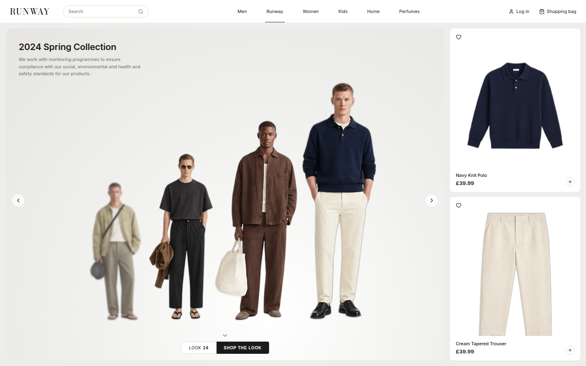

<div align="center">

# 👔 Runway

**A menswear runway page with a smooth, animated look carousel.**

Scroll through the looks and the shirt and pants for the model in focus slide in right next to the carousel.




</div>

## ✨ Features

- 🎠 **Runway carousel** — the model in focus stands tall, older looks shrink, blur and fade into the back
- 👕 **Shop the look** — big shirt and pants cards for the model in focus
- 🔄 **Always in sync** — scroll the carousel or the cards, both move together
- 🖱️ **Every way to browse** — mouse wheel, trackpad, swipe, drag or arrow buttons
- 🌊 **Smooth spring animations** with Motion
- 📱 **Responsive** — works on desktop and mobile
- 🧪 **Tested** — every component has its own unit tests

## 🚀 Getting started

```bash
npm install
npm run dev
```

Then open http://localhost:5173

## 📜 Scripts

| Command | What it does |
| --- | --- |
| `npm run dev` | ⚡ Start the dev server |
| `npm run build` | 📦 Type check and build for production |
| `npm run preview` | 👀 Serve the production build |
| `npm test` | 🧪 Run the tests once |
| `npm run test:watch` | 🔁 Run the tests on every save |
| `npm run lint` | 🧹 Lint the code |

## 🧠 How it works

There is one piece of state: `active`, the index of the look in focus. It lives in `App.tsx`.

- 🎠 The **carousel** shows every model. Each model gets a `depth` (how far it is behind the focused one) and moves to the spot for that depth.
- 👕 The **product panel** shows a shirt and pants card for every look, side by side, and slides to the active one.
- 🔄 Scrolling, swiping or clicking the arrows on either side calls `step(1)` or `step(-1)`, so both always show the same look.

## 📁 Project structure

```
public/assets/
├── looks/                  🧍 full models for the carousel
└── products/
    ├── tops/               👕
    ├── bottoms/            👖
    └── accessories/        👞 👜 🧢
design/
└── lookbook-sheet.png      🎨 the original asset sheet

src/
├── App.tsx                 🧠 holds the active look
├── components/
│   ├── Header.tsx          🧭 logo, search, nav
│   ├── Runway.tsx          🎠 carousel stage, arrows, look number
│   ├── RunwayModel.tsx     🧍 one model in the carousel
│   ├── ProductPanel.tsx    🛍️ sliding shirt and pants cards
│   └── ProductCard.tsx     🏷️ one product card
├── animations/
│   ├── runway.ts           📍 where each model sits in the carousel
│   └── products.ts         ✨ how the cards fade and scale
├── hooks/
│   └── useStepGestures.ts  🖱️ wheel and swipe to next or previous
└── data/
    ├── products.ts         📋 every product
    └── looks.ts            🔗 every look and its products
```

Each component has its own `.css` file and a `.test.tsx` file next to it.

## 🛠️ Changing things

➕ **Add a product** — put the image in `public/assets/products/<category>/<id>.webp` and add a line to `src/data/products.ts`.

🧍 **Add a look** — put the image in `public/assets/looks/<id>.webp` and add a line to `src/data/looks.ts` with the product ids it uses. Each look needs one top and one bottom.

📍 **Change the carousel** — edit the `spots` list in `src/animations/runway.ts`. The first spot is the model in focus, the next ones are the models behind it. Change `left` to spread them out, `scale` for size, `filter` for blur.

⏱️ **Change the speed** — edit `runwaySpring` in `src/animations/runway.ts` and `outfitSpring` in `src/animations/products.ts`. Lower `stiffness` is slower, higher `damping` is less bouncy.

## 🧪 Tests

Tests use Vitest and Testing Library.

- ✅ Every component renders the right content and calls `onStep` on arrows, wheel and swipe
- ✅ `App` keeps the carousel and cards on the same look and stops at the first and last look
- ✅ The data has a top and a bottom for every look, and every image file exists

```bash
npm test
```

## 🧰 Built with

- ⚛️ [React](https://react.dev)
- 🟦 [TypeScript](https://www.typescriptlang.org)
- ⚡ [Vite](https://vite.dev)
- 🌊 [Motion](https://motion.dev)
- 🎨 [Lucide](https://lucide.dev) icons
- 🧪 [Vitest](https://vitest.dev) + [Testing Library](https://testing-library.com)
